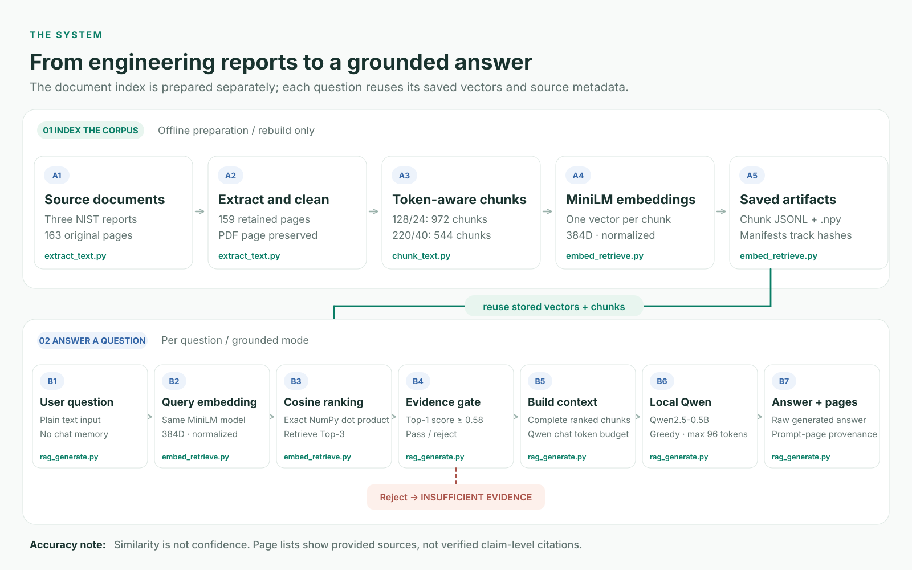
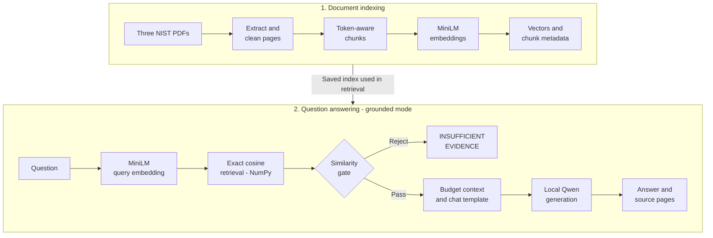
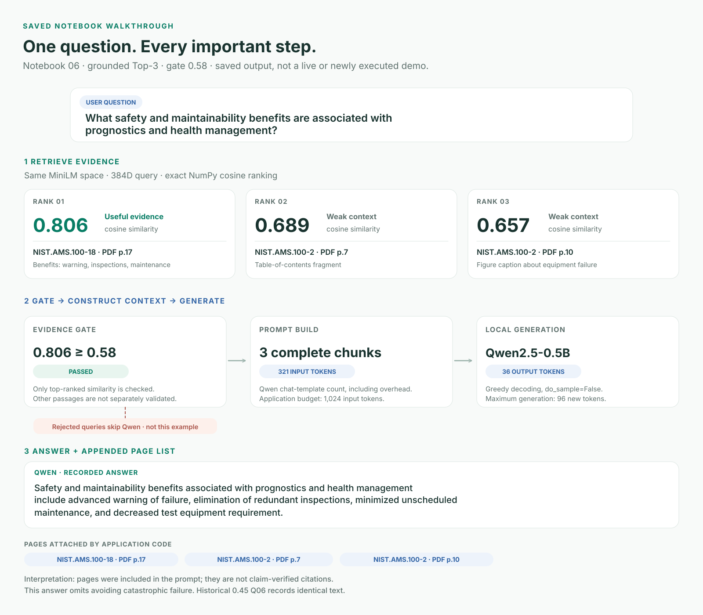

# Engineering Document RAG Assistant

A **self-directed learning prototype** that answers general manufacturing-maintenance questions using three public NIST reports. Built to learn document processing, semantic retrieval, grounded prompting, and evaluation—not for production diagnosis or equipment-specific maintenance instructions.

**Python · pypdf · Sentence Transformers · NumPy · Hugging Face Transformers · Local Qwen**

[Architecture](#architecture) · [Recorded example](#recorded-example) · [Results and limitations](#results-and-limitations) · [Implementation](#explore-the-implementation) · [Notebooks](#explore-the-notebooks) · [Run locally](#run-locally)

## Architecture

Prepare the document index first; reuse it when answering questions.

<picture>
  <source media="(prefers-color-scheme: dark)" srcset="assets/visuals/architecture-dark.svg">
  
</picture>

[Full-resolution light SVG](assets/visuals/architecture-light.svg) · [Full-resolution dark SVG](assets/visuals/architecture-dark.svg)

[PDF extraction](src/extract_text.py) · [Chunking](src/chunk_text.py) · [Retrieval](src/embed_retrieve.py) · [Generation](src/rag_generate.py) · [Notebook walkthrough](notebooks/06_end_to_end_rag_query_walkthrough.ipynb)


<details>
<summary>View original Mermaid flowchart</summary>



</details>

**Indexing:** 163 original PDF pages → 159 retained page records → 972 chunks at 128 tokens or 544 at 220 tokens → normalized 384-dimensional vectors. The examples use the 128-token corpus. [Source documents](SOURCES.md) · [Saved data](data/)

**Answering:** the same MiniLM model embeds each question. Grounded mode checks the highest retrieval score before building the Qwen prompt. The current default threshold is **0.58**; the historical four-configuration experiment used **0.45**. Basic prompts bypass this gate. Similarity is not a probability.

Displayed pages identify the evidence supplied to the generator. They do **not** verify every generated claim.

## Recorded example

**Saved notebook 06 walkthrough · grounded Top-3 · 128-token chunks · gate 0.58 · local Qwen**


<picture>
  <source media="(prefers-color-scheme: dark)" srcset="assets/visuals/recorded-trace-dark.svg">
  
</picture>

[Full-resolution light SVG](assets/visuals/recorded-trace-light.svg) · [Full-resolution dark SVG](assets/visuals/recorded-trace-dark.svg)

[Recorded notebook](notebooks/06_end_to_end_rag_query_walkthrough.ipynb) · [Retrieval code](src/embed_retrieve.py) · [Prompt and generation code](src/rag_generate.py)

Static recorded evidence, not a live or newly executed demo. Historical Q06 at **0.45** contains the same answer. The page list records supplied context, not claim-verified citations; the answer omits avoiding catastrophic failure.

<details>
<summary>Inspect the recorded passages, exact prompt, answer and provenance</summary>

> **User**
>
> What safety and maintainability benefits are associated with prognostics and health management?

**1. Embed and retrieve.** The notebook embeds the question as a normalized 384-dimensional vector, then ranks stored chunks by their dot product with it. Its saved retrieval table contains:

| Rank | Document / PDF page | Cosine similarity | What the chunk contains |
|---|---|---:|---|
| 1 | NIST.AMS.100-18 / 17 | 0.806 | Safety and maintainability benefits |
| 2 | NIST.AMS.100-2 / 7 | 0.689 | Table-of-contents fragment |
| 3 | NIST.AMS.100-2 / 10 | 0.657 | Figure caption about detecting and mitigating equipment failure |

The first passage states:

> • Safety: Advance warning of failure and avoiding a catastrophic failure
> 
> • Maintainability: Eliminating redundant inspections, minimizing unscheduled maintenance, and decreasing test equipment requirement

**2. Check the evidence gate.** Saved output: `Top similarity: 0.806`, `Required minimum: 0.58`, `Evidence passed: True`. This gate checks the top score, not the relevance of every passage.

**3. Construct the context.** All three complete chunks fit the 1,024-token budget. The prompt asks for a concise answer using only the evidence; Qwen's chat template brings the input to **321 tokens**.

<details>
<summary>Inspect the full recorded prompt</summary>

This is the saved raw prompt before the chat template is applied. The 321-token count includes the chat template, not just the text below.

```text
Answer using only the evidence below in no more than three concise sentences. State the answer directly, do not discuss these instructions, and do not use outside knowledge. Source citations are attached separately by the system.

EVIDENCE:
[S1 | NIST.AMS.100-18, PDF p.17]
Bo et al identify a number of benefits of prognostics and health management, a component related to predictive maintenance, which include34:
• Safety: Advance warning of failure and avoiding a catastrophic failure
• Maintainability: Eliminating redundant inspections, minimizing unscheduled maintenance, and decreasing test equipment requirement
• Logistics: Improving and assisting in the design of logistical support system
• Life-cycle costs: reducing operational and support costs
• System design and analysis: Improving design and qualifications along with improving reliability prediction accuracy
• Reliability: Making products more reliable

[S2 | NIST.AMS.100-2, PDF p.7]
3
1.2.
Background and Importance of Prognostics and Health Management ..........................................
3
1.3.

[S3 | NIST.AMS.100-2, PDF p.10]
Figure 1-1.
General Prognostics and Health
Management Design Components to Detect and
Mitigate Equipment Failure

QUESTION: What safety and maintainability benefits are associated with prognostics and health management?
ANSWER:
```

</details>

**4. Generate.** The notebook calls Qwen with greedy decoding (`do_sample=False`, at most 96 new tokens); its saved output records 36 generated tokens.

> **Qwen — recorded answer**
>
> Safety and maintainability benefits associated with prognostics and health management include advanced warning of failure, elimination of redundant inspections, minimized unscheduled maintenance, and decreased test equipment requirement.

**5. Display source pages.** The application appends metadata for the deduplicated pages included in the prompt:

```text
Retrieved sources:
1. NIST.AMS.100-18 — PDF page 17
2. NIST.AMS.100-2 — PDF page 7
3. NIST.AMS.100-2 — PDF page 10
```

**What to notice:** the answer covers warning, inspections, unscheduled maintenance, and test equipment, but omits avoiding catastrophic failure. Two retrieved chunks offer weak context. Listing all three pages records available evidence; it does not establish that all three support the answer.

<details>
<summary>Where this example comes from: 0.58 walkthrough versus 0.45 experiment</summary>

[Notebook 06](notebooks/06_end_to_end_rag_query_walkthrough.ipynb) has saved execution counts 1–9. The gate cell explicitly sets **0.58** and records a pass; later cells build the prompt, call `generator_model.generate(...)`, decode the answer, and display sources. These are separately saved notebook cells and outputs, rather than a notebook that loads its answer from the experiment JSON.

The answer, 321-token input, and source pages also match Q06 in the [historical experiment](evaluation/rag_experiment_results.json), whose recorded threshold is **0.45**. The top score exceeds both thresholds; the gate does not alter the prompt after passing, so matching output is consistent with greedy generation.

This example is labelled by the notebook's saved 0.58 sequence. It is **not a newly executed 0.58 result**, a new quality experiment, or proof that raising the threshold improved this answer. Saved cells and execution counts cannot independently certify execution history. No generation was rerun for this presentation update.

</details>

</details>

## Results and limitations

Corpus artifacts contain 163 original PDF pages, 159 retained pages, 972 chunks at 128 tokens, and 544 at 220 tokens.

Historical retrieval results on ten labelled questions (notebook 03):

| Chunk target / overlap target | Hit@1 | Hit@3 | Hit@5 | MRR |
|---|---:|---:|---:|---:|
| 128 / 24 | 50% | 90% | 90% | 0.633 |
| 220 / 40 | 50% | 70% | 80% | 0.619 |

This small comparison motivated the 128-token selection; it does not establish that smaller chunks always win.

`evaluation/rag_experiment_results.json` records **0.45**, 13 questions (10 supported, 3 unsupported), four configurations, and 52 rows:

| Historical configuration | Supported phrase coverage | Expected source reached prompt | Unsupported refusal |
|---|---:|---:|---:|
| Basic Top-3 | 55.0% | 90% | 2/3 |
| Basic Top-5 | 55.0% | 90% | 2/3 |
| Grounded Top-3 | 58.3% | 90% | 2/3 |
| Grounded Top-5 | 55.0% | 90% | 2/3 |

The basic configurations do not apply the gate. Grounded Top-3 used 476.5 mean input tokens versus 718.8 for Top-5 when generation was called. Manual review of the historical grounded Top-3 answers gave 63.3% point coverage: 3 supported, 2 mostly supported, 4 partially supported, 1 unsupported. Phrase coverage is a heuristic, not a correctness score. Q06 illustrates a phrase-matcher false negative; Q04 is a genuine retrieval failure followed by an inadequately grounded answer.

**Current default versus historical evidence:** `run_rag()` now uses 0.58. The experiment function retains 0.45 as its historical default. Notebook 05 derives a provisional midpoint from observed scores; notebook 07 checks five new unsupported questions at 0.58, with 5/5 rejected and a narrowest margin about 0.010. Those gate-only checks are not a new full 0.58 answer-quality experiment. The 58.3% and 63.3% figures remain descriptions of historical 0.45 answers.

### Limitations and future work

Only three reports and small hand-labelled question sets are covered. Cleaning can retain PDF spacing artifacts and flattened tables; there is no OCR, table parser, reranker, or hybrid search. The small generator can omit evidence or hallucinate even when a relevant page is supplied. Top-score gating cannot detect every unsupported question or guarantee that retrieval answers the actual question. The narrow holdout margin and calibration-set reuse limit confidence.

Next learning steps: improve Q04 retrieval, add independently labelled supported and unsupported holdouts, validate faithful claims separately from source presence, compare hybrid/reranked retrieval, record exact model revisions and a tested environment lock, and test fresh installation. A UI or deployment is optional future work. Use approved procedures for real maintenance decisions.

## Explore the implementation

Five modules separate document preparation, retrieval, generation, and evaluation. Expand a stage to revisit what the code does and why.

<details>
<summary>1. extract_text.py — preserve evidence while cleaning PDFs</summary>

**Problem:** PDF page layout is not clean retrieval text, and losing page identity makes answers difficult to inspect.

**What it does:** `extract_document()` uses pypdf to read each page. `find_repeated_edge_lines()` detects repeated page furniture; `clean_page_text()` removes it and isolated page numbers, repairs cross-line hyphenation, and normalizes wrapping. Pages shorter than 30 cleaned characters are excluded. JSONL records retain both raw and cleaned text, document/filename, and one-based PDF page; a separate report records exclusions and diagnostics.

**Why this approach:** direct extraction works for these digital PDFs without introducing OCR. Retaining raw text makes cleaning decisions reviewable rather than irreversible.

**Engineering lesson:** capture provenance before transforming content. PDF page indices differ from printed report labels.

**Limitations:** rule-based cleaning can retain split words and flattened tables or remove meaningful repeated text. There is no OCR or table parser; inspection still matters.

[Inspect source](src/extract_text.py) · [Notebook 01: extraction and cleaning](notebooks/01_pdf_extraction_and_cleaning.ipynb)

</details>

<details>
<summary>2. chunk_text.py — fit the embedding model without losing page boundaries</summary>

**Problem:** pages can exceed the embedding model's input limit; word counts do not reliably predict token counts.

**What it does:** the MiniLM tokenizer counts tokens including special tokens. Lightweight sentence/paragraph units are greedily packed into page-contained chunks. Oversized units are token-split. `choose_overlap_start()` carries complete trailing units, with a bounded fallback; `validate_chunks()` reports IDs, budgets, page coverage and measured adjacent overlap. Both 128/24 and 220/40 corpora are saved.

**Why this approach:** both targets remain below MiniLM's 256-token limit. Complete units preserve readable evidence; two sizes allow an actual retrieval comparison. Text is not stemmed or stripped of stop words before transformer encoding.

**Engineering lesson:** overlap is a target, not a guaranteed count. Keeping document/page boundaries makes provenance unambiguous, but structural validity alone does not establish retrieval quality.

**Limitations:** sentence splitting is heuristic, some pairs have little or no overlap, and page boundaries can split concepts. Chunk-size conclusions come from only ten labelled retrieval questions.

[Inspect source](src/chunk_text.py) · [Notebook 02: token-aware chunking](notebooks/02_token_aware_chunking.ipynb)

</details>

<details>
<summary>3. embed_retrieve.py — make semantic search transparent and checkable</summary>

**Problem:** find relevant evidence even when the question and passage use different words, while keeping vector rows tied to their text.

**What it does:** SentenceTransformer encodes chunks and questions in the same MiniLM space. Document vectors are normalized float32 arrays with 384 dimensions. `retrieve_top_k()` computes `embeddings @ query_vector` and sorts exact scores. Saved manifests record the chunk-file SHA-256 and row endpoints; validation checks dimensions, norms, finite values and row counts. `evaluate_retrieval()` measures page-level Hit@1/3/5 and MRR.

**Why this approach:** normalization makes the dot product equal cosine similarity. Exact NumPy search is sufficient for 972 vectors and exposes the ranking calculation without a database layer. The measured comparison motivated the 128-token corpus used in examples.

**Engineering lesson:** vector/metadata alignment is part of correctness. A manifest enables artifact checks; runtime retrieval only checks row counts, so run the validator after changing data.

**Limitations:** dense similarity can rank contents pages or captions highly. There is no hybrid lexical search or reranking, and a high score does not prove the passage answers the question.

[Inspect source](src/embed_retrieve.py) · [Notebook 03: embeddings and retrieval](notebooks/03_embeddings_and_semantic_retrieval.ipynb)

</details>

<details>
<summary>4. rag_generate.py — control the evidence and context given to Qwen</summary>

**Problem:** a language model can produce fluent unsupported answers or exceed a chosen input budget.

**What it does:** `run_rag()` retrieves chunks and rejects low top scores for grounded requests. `build_prompt()` adds complete ranked chunks, counts tokens through the generator's chat template, and stops at the first chunk that cannot fit. `generate_answer()` uses greedy decoding. After generation, document/pages from the selected chunks are deduplicated and appended separately from model text.

**Why this approach:** retrieval and generation have separate models, so changing the generator does not require rebuilding the embeddings. The budget applies to actual Qwen tokens rather than MiniLM tokens or character estimates. Source metadata comes from the pipeline rather than model memory.

**Engineering lesson:** requested Top-k can differ from chunks that fit. Provenance records supplied context; it is not claim-level attribution. The legacy `citations` and `citation_present` result fields refer to that source list, not verified generated citations.

**Defaults and boundaries:** `run_rag()` uses grounded Top-3, 0.58 and 1,024 input tokens; `build_prompt()` alone defaults to 512. Generation allows 96 new tokens. Basic prompts bypass the gate. If no complete source fits, prompt construction raises an error. Greedy decoding does not guarantee identical results across model revisions, libraries or hardware.

**Limitations:** the gate checks one score and is not a probability or safety guarantee. Even relevant context can yield omissions or hallucinations. The prototype has no claim-level faithfulness checker.

[Inspect source](src/rag_generate.py) · [Notebook 04: grounded generation](notebooks/04_rag_and_prompt_engineering.ipynb) · [Notebook 06: end-to-end walkthrough](notebooks/06_end_to_end_rag_query_walkthrough.ipynb)

</details>

<details>
<summary>5. evaluate_rag.py — measure failures without hiding experiment history</summary>

**Problem:** fluent examples alone do not show whether retrieval, answers, or refusals are reliable.

**What it does:** four configurations compare basic/grounded prompts and Top-3/Top-5. Answer-point scoring checks accepted phrases in raw model text; expected-source checks inspect pages supplied to the prompt; refusal scoring uses explicit wording. Per-question evidence and aggregate quality, token and generation-latency fields are retained. The CLI requires a new output path and refuses existing destinations before loading models.

**Why this approach:** small, inspectable labelled sets make the experiment understandable. Raw outputs and a separate manual review expose scoring errors and actual failures rather than collapsing everything into one accuracy number.

**Engineering lesson:** separate retrieval quality, source presence, answer coverage and refusal. More context did not improve this experiment. `run_experiment()` retains **0.45** as its historical default; `run_rag()` defaults to **0.58**. Choose the threshold explicitly for a new experiment and never relabel historical answers.

**Limitations:** phrase matching misses paraphrases and can reward wrong statements containing the right words. Refusal matching is heuristic. Manual coverage is documented judgment, not an independent large-scale benchmark. Recorded latency measures generation, not total end-to-end time. The small sets and calibration reuse limit generalization.

[Inspect source](src/evaluate_rag.py) · [Notebook 05: historical experiments](notebooks/05_rag_evaluation_and_context_experiments.ipynb) · [Notebook 07: final error analysis](notebooks/07_final_error_analysis.ipynb) · [Manual review](evaluation/manual_grounded_top3_review.json)

</details>

## Explore the notebooks

Read in order for the learning path, or start with notebook 06 to follow one question through the system.

| Notebook | What to explore |
|---|---|
| [01 · PDF extraction and cleaning](notebooks/01_pdf_extraction_and_cleaning.ipynb) | Inspect raw text, cleaning rules and source metadata |
| [02 · Token-aware chunking](notebooks/02_token_aware_chunking.ipynb) | Compare chunk budgets, structure and overlap |
| [03 · Embeddings and semantic retrieval](notebooks/03_embeddings_and_semantic_retrieval.ipynb) | Follow vector search and compare retrieval metrics |
| [04 · RAG and prompt engineering](notebooks/04_rag_and_prompt_engineering.ipynb) | Inspect context budgeting, generation and refusal |
| [05 · Evaluation and context experiments](notebooks/05_rag_evaluation_and_context_experiments.ipynb) | Analyze the saved historical 0.45 experiment |
| [06 · End-to-end query walkthrough](notebooks/06_end_to_end_rag_query_walkthrough.ipynb) | Trace the recorded 0.58 example shown above |
| [07 · Final error analysis](notebooks/07_final_error_analysis.ipynb) | Compare manual scoring and later unsupported gate checks |

Saved outputs are historical observations, not proof that a new environment works. Notebooks 01/02 regenerate data; 03/04/06/07 load models or run inference. Notebook 05 reads saved results rather than rerunning the experiment. Read first; rerun deliberately. Launch from the root or `notebooks/`, since notebook root detection assumes one of those locations.

For a function-by-function study guide, see [Learning checkpoints](LEARNING_CHECKPOINTS.md).

## Run locally

Python 3.10 is the locally exercised version. Other versions have not been validated. CPU execution is supported; allow several GB of free disk and RAM for downloads and loading models. No paid API key is required for the public models.

```powershell
py -3.10 -m venv .venv
.\.venv\Scripts\Activate.ps1
python -m pip install --upgrade pip
python -m pip install -r requirements.txt
python -m pip check
python scripts/download_models.py
python scripts/validate_project.py
```

If PowerShell activation is restricted, call `.\.venv\Scripts\python.exe` directly. Use the environment's Python for every command and select its kernel in Jupyter. [requirements.txt](requirements.txt) declares direct dependencies and version ranges; [requirements-observed.txt](requirements-observed.txt) records versions observed on the original machine as a troubleshooting reference, not a complete lockfile or proof of a clean installation.

The download script uses Hugging Face `snapshot_download`, documented in the [official download guide](https://huggingface.co/docs/huggingface_hub/v0.26.3/guides/download), for [MiniLM](https://huggingface.co/sentence-transformers/all-MiniLM-L6-v2) and [Qwen](https://huggingface.co/Qwen/Qwen2.5-0.5B-Instruct). It downloads PyTorch safetensors/configuration/tokenizer assets into `models/all-MiniLM-L6-v2/` and `models/qwen2.5-0.5b-instruct/`, then saves a tokenizer copy in `models/all-MiniLM-L6-v2-tokenizer/`. Internet is needed for this step. FLAN-T5 is an earlier experiment and is not needed. Downloads currently follow the model repository default revision: exact historical model revisions were not recorded, so bit-for-bit historical reproduction is not promised.

The repository includes the three PDFs; official download links and titles are in [SOURCES.md](SOURCES.md) if they need to be restored. Model weights and caches are excluded. The small saved embedding arrays are included so the walkthrough can use the existing evidence immediately after model setup.

<details>
<summary>Run a query from Python</summary>

Run this Python from the project root (or use notebook 06):

```python
from pathlib import Path
import numpy as np
from src.embed_retrieve import load_embedding_model, read_jsonl
from src.rag_generate import load_generator, run_rag

root = Path.cwd()
retriever = load_embedding_model(root / 'models/all-MiniLM-L6-v2')
chunks = read_jsonl(root / 'data/processed/chunks_128.jsonl')
vectors = np.load(root / 'data/embeddings/embeddings_128.npy')
tokenizer, generator = load_generator(root / 'models/qwen2.5-0.5b-instruct')
result = run_rag(
    'Which measurable units can be used to schedule preventive maintenance?',
    retriever, vectors, chunks, tokenizer, generator,
)
print(result['answer'])
```

Historical Q02 (`grounded_top3`, threshold **0.45**) listed time (months), distance (miles), and cycles, with source pages NIST.AMS.100-34 p.15 and NIST.AMS.100-18 pp.10,15. This is a summary of a saved answer, not an exact expected output for a new run. Low-scoring grounded queries return `INSUFFICIENT EVIDENCE` before generation. See the unsupported questions in `evaluation/` for examples; their company/location references are synthetic negative-test prompts, not operational company data.

</details>

<details>
<summary>Validation, rebuilding artifacts and intentional new experiments</summary>

A small offline validation after downloading models:

```powershell
python scripts/validate_project.py --models
```

This checks existing artifacts, evaluates retrieval for both chunk designs, checks five unsupported questions, and generates one supported answer plus one gated query. It does not rerun the 52-answer experiment. [Validator source](scripts/validate_project.py) · [Checks actually run and environment caveats](docs/VALIDATION_NOTES.md)

Optional full data rebuild: these commands overwrite generated data/embeddings. Copy those artifacts elsewhere first if preserving exact originals.

```powershell
python -m src.extract_text
python -m src.chunk_text
python -m src.embed_retrieve
```

For an intentional new experiment, always choose a new output path and state the threshold explicitly:

```powershell
python -m src.evaluate_rag --minimum-evidence-score 0.58 --output evaluation/rag_experiment_058_new.json
```

The CLI refuses existing destinations before loading models and never overwrites historical evidence. A rerun uses today's code and model files; selecting 0.45 alone does not reconstruct an older code revision.

</details>

## Repository guide

| Location | Contents |
|---|---|
| [src/](src/) | Five pipeline and evaluation modules |
| [data/raw/](data/raw/) | Three original NIST PDFs |
| [data/processed/](data/processed/) | Raw/cleaned page text, extraction report and chunk corpora |
| [data/embeddings/](data/embeddings/) | Small vector arrays and source-hash manifests |
| [evaluation/](evaluation/) | Questions, historical generated answers and manual review |
| [scripts/](scripts/) | Model download and validation utilities |

See [Validation notes](docs/VALIDATION_NOTES.md) for checks actually run, their dates, environment caveats and remaining reproducibility limitations.
